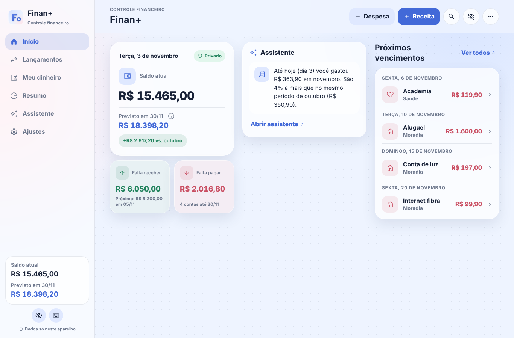

# Finan+ web (PWA)

**Português:** [README.md](README.md)

Simple, private and offline personal finance in the browser, on your phone or computer. It does everything the Android app does — income, expenses, accounts, credit cards and bills, installments, recurring entries, limits, goals, reports, PDF report, an on-device assistant, PIN lock and a compatible backup — with its own **layout for computers and laptops**.



The app itself is in Brazilian Portuguese and uses the Brazilian real (R$). The detailed feature documents are in Portuguese.

**Use it now:** https://finanplus-web.github.io/finan_plus/ · **Linux version:** [download the .deb](https://github.com/finanplus-web/finan_plus_linux/releases/latest) · **Android:** [F-Droid](https://f-droid.org/packages/com.finanplus/)

## What's new in 1.5.0

Finan+ web now has the same look and rules as the Android app 1.11.0:

- **One number, one name, one rule:** the same To receive, To pay, Reserved for goals and Forecast numbers on every screen (money already saved in a goal is not subtracted again; overdue items show up in "To pay").
- **Redesigned Home, Summary and Transactions**, with the new transaction screen (category and date chips, a collapsed "More options" and Undo after saving).
- **My money** with dedicated pages: Accounts and cards (the bill inside each card, limit usage), Debts, Limits, Goals and Categories (drag to reorder, archive with Undo).
- **Goal reserves, shared expenses** (PDF and image), **balance carried over between months**, **optional glass effect**, a **welcome tour** and an encrypted **automatic backup** to a folder (Chrome and Edge on desktop).
- Backups now keep the Android app's goal reserves and shared expenses.

Full list: [CHANGELOG.md](CHANGELOG.md) (Portuguese).

## Your data

Everything stays in your browser: the data is encrypted (AES-256-GCM) in the site's IndexedDB, with a non-extractable WebCrypto key. No account, no server, no ads, no trackers. JSON backups are compatible with the Android and Linux versions. Clearing the site's data in the browser deletes everything, so keep backups.

## Development

```bash
npm ci
npm test        # business rules (node:test)
npm run build   # js/app.bundle.js
npm run preview # build and serve the site locally
```

## License

GNU GPL v3 or later. Third-party components and their licenses are listed in the `licenca/` and `third_party/` folders.
